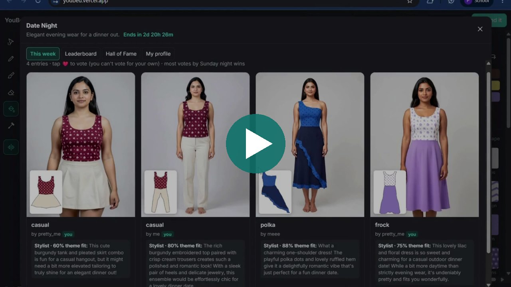
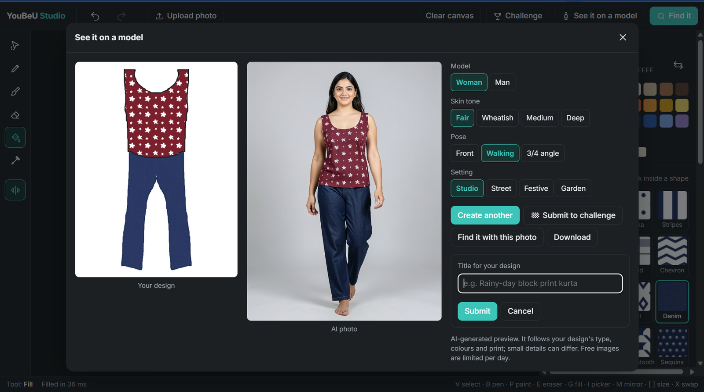
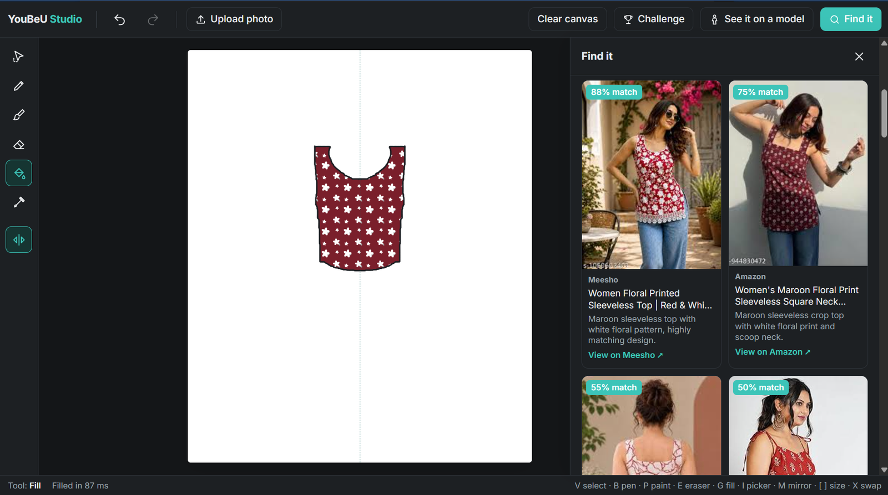
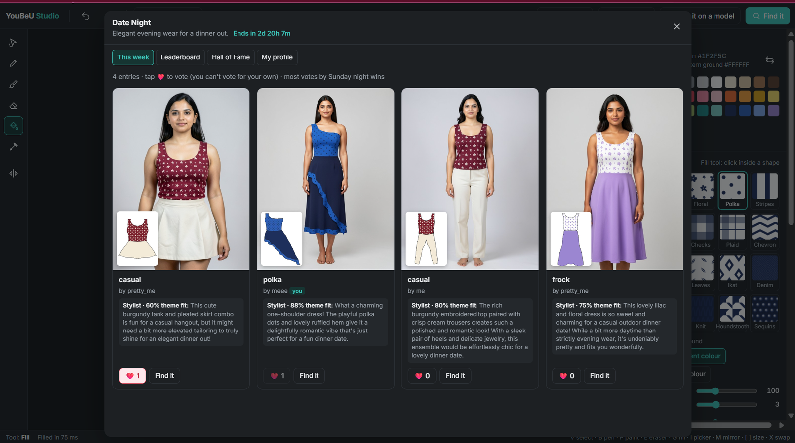
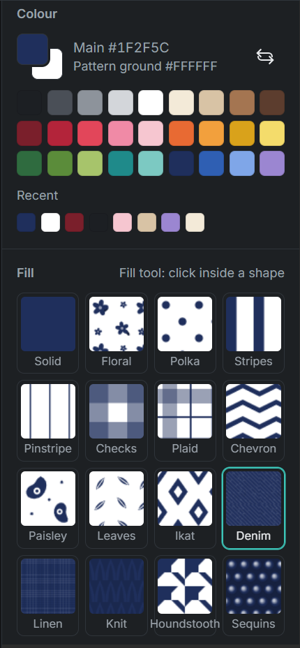
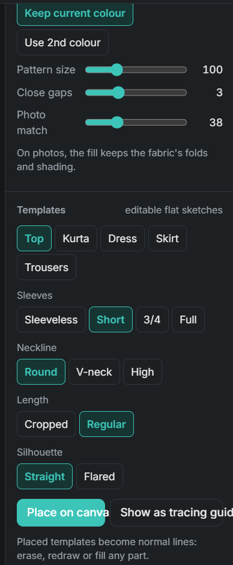

# YouBeU Studio

Draw the outfit in your head, or edit a real dress photo. See it on a model, find similar products in real stores, and enter it in a weekly design challenge.

**Try it:** https://youbeu.vercel.app · **Demo video (1 min):** https://youbeu.vercel.app/demo.mp4

[](https://youbeu.vercel.app/demo.mp4)

<table>
<tr>
<td width="50%"><b>Sketch → AI model photo</b><br></td>
<td width="50%"><b>Find it: real products ranked by how they look</b><br></td>
</tr>
</table>
<table>
<tr>
<td><b>Weekly challenge</b><br></td>
<td><b>Colours and prints</b><br></td>
<td><b>Templates</b><br></td>
</tr>
</table>

## Features

- **Sketchboard:** pen, paint, eraser, mirror mode, layers, select and move, undo, and editable templates (top, kurta, dress, skirt, trousers)
- **Colours and 16 prints:** floral, ikat, paisley, checks, denim and more. Prints can sit on top of an existing colour.
- **Edit a dress photo:** the garment is detected automatically. Recolour it, add a print (folds and shading kept), change the length or add sleeves.
- **See it on a model:** an AI photo of a model wearing your design. You choose the model, skin tone, pose and setting.
- **Find it:** real products from Myntra, Amazon, Flipkart, Meesho and AJIO, ranked by how closely they look like your design
- **Weekly challenge:** submit, vote, points, badges, leaderboard, Hall of Fame, and an AI stylist note on each entry

## How it works

- **Studio and photo edits** run in the browser (canvas, flood fill, colour clustering).
- **Gemini** reads designs, locates garments in photos and writes stylist notes.
- **FLUX.2** on Cloudflare Workers AI generates the model photos, using the design as a reference.
- **SerpAPI** searches the stores, then Gemini ranks the results by visual similarity.
- **Upstash Redis** stores challenge entries, votes and points.
- All API keys stay on the server (`api/`), never in the page.

## Use this repo

**Just the studio (no setup):** download the repo and open `index.html` in a browser. Drawing, templates, prints and manual photo recolouring all work offline. The AI features need the deployed backend.

**Deploy your own copy (free):**
1. Fork this repo and import it at [vercel.com](https://vercel.com) (**Add New → Project**, preset **Other**).
2. In **Settings → Environment Variables**, add:

   | Variable | Where to get it | Used for |
   |---|---|---|
   | `GEMINI_API_KEY` | [aistudio.google.com](https://aistudio.google.com) → Get API key | reading designs, garment detection, stylist notes |
   | `SERPAPI_KEY` | [serpapi.com](https://serpapi.com) → dashboard | Find it |
   | `CF_ACCOUNT_ID`, `CF_API_TOKEN` | Cloudflare → AI → Workers AI → Use REST API | model photos |
   | `KV_REST_API_URL`, `KV_REST_API_TOKEN` | Vercel → Marketplace → Upstash Redis → connect to the project (added for you) | weekly challenge |

3. Deploy (or redeploy after adding variables). Then open `/api/health` to check that every service is connected.

Each feature works on its own, so you only need the keys for the features you want.

**Change the code:** edit `src/studio.html` (UI and tools) or `src/engine.js` (garment templates), then run `python3 build.py` to rebuild `index.html`. The server functions are in `api/`.

```
index.html        the app (built from src/)
src/              studio UI and garment engine
api/              find, detect, render, challenge, health (Vercel functions)
docs/             README images and video cover
demo.mp4          1-minute demo video
```
